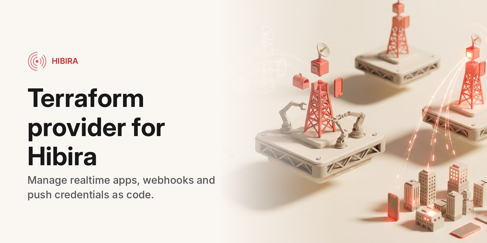

# Terraform provider for Hibira



Manage [Hibira](https://hibira.io) apps, webhooks and push notification credentials with Terraform. Hibira is a hosted, Pusher-compatible realtime WebSocket service.

```hcl
terraform {
  required_providers {
    hibira = {
      source  = "hibira-io/hibira"
      version = "~> 0.1"
    }
  }
}

provider "hibira" {} # reads HIBIRA_API_TOKEN

resource "hibira_app" "chat" {
  name            = "chat-prod"
  client_events   = true
  allowed_origins = ["https://example.com"]
}

resource "hibira_webhook" "presence" {
  app_id = hibira_app.chat.id
  url    = "https://example.com/hooks/hibira"
  events = ["member_added", "member_removed"]
}

output "app_key" {
  value = hibira_app.chat.key
}
```

Make the token on the portal's [API tokens](https://hibira.io/portal/api-tokens) page: a personal access token with read and write access. Operations console tokens (`hbc_...`) don't work here: the provider calls the customer API, and the console's tokens only reach the console.

| | |
|---|---|
| `hibira_app` | An app: its key, secret, allowed origins, client events and other settings. |
| `hibira_webhook` | One webhook endpoint of an app and the events it receives. |
| `hibira_push` | An app's push notifications (Beams-compatible) with APNs and FCM credentials. |
| `hibira_waiting_room` | A waiting room in front of a ticket drop or launch: rate, state, start time, return URLs. |
| `hibira_approvals_workspace` | A [Hibira Approvals](https://hibira.io/approvals) workspace: who answers your agents' and workflows' approval requests, their roles and approver groups. |
| `data.hibira_app`, `data.hibira_apps` | Read existing apps. |

Full documentation is on the [Terraform Registry](https://registry.terraform.io/providers/hibira-io/hibira/latest/docs) and in [docs/](docs).

## Development

Requires Go (see `go.mod`) and Terraform.

```sh
go build ./...
go test ./...            # unit tests
go generate ./...        # regenerate docs/ after changing a schema, examples/ or templates/
```

Acceptance tests create and delete real apps (named `tf-acc*`), so point them at a test account or a local server:

```sh
TF_ACC=1 HIBIRA_API_TOKEN=hkb_pat_... HIBIRA_ENDPOINT=http://localhost:8080 go test ./internal/provider/ -v
```

To try a local build, add a [dev override](https://developer.hashicorp.com/terraform/cli/config/config-file#development-overrides-for-provider-developers) for `hibira-io/hibira` pointing at your `GOBIN`, then `go install .`.

## Releasing

Push a `vX.Y.Z` tag. The release workflow builds every platform with goreleaser, signs the checksums with the GPG key in the repository secrets, and creates the GitHub release the Terraform Registry picks up.

## License

MIT
